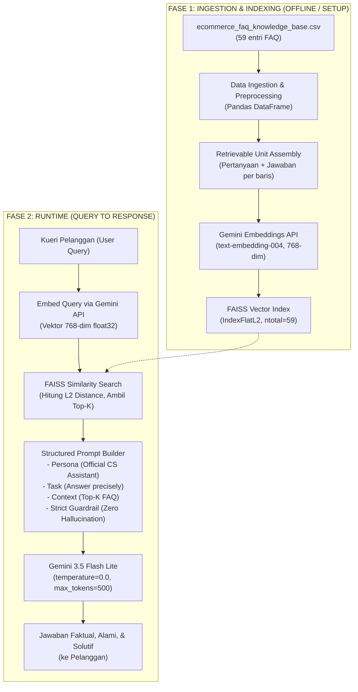

# E-Commerce Customer Support AI Assistant
## Semantic Search & Grounded LLM Response Generator

Proyek ini adalah implementasi end-to-end sistem tanya-jawab cerdas (*Question-Answering System*) untuk layanan pelanggan (*Customer Service*) e-commerce berbasis **Semantic Search** dan **Large Language Model (LLM)**. Sistem ini dirancang untuk memproses dan mengindeks basis pengetahuan FAQ internal, mencari informasi paling relevan berdasarkan esensi makna pertanyaan (*semantic similarity*), serta menyusun jawaban yang alami, akurat, dan bebas dari halusinasi (*zero hallucination*) dengan *strict guardrails*.

---

## 1. Problem Statement & Business Context

### 1.1 Latar Belakang & Tantangan Operasional
Tim *Customer Service* (CS) platform e-commerce menghadapi volume tiket harian yang sangat tinggi. Sebagian besar tiket mencakup pertanyaan repetitif seputar estimasi waktu pengiriman, opsi pembayaran, pembatalan pesanan, dan kebijakan pengembalian barang (*retur*). Penanganan manual oleh staf CS menyita waktu dan biaya operasional yang signifikan.

### 1.2 Keterbatasan Solusi Eksisting
1. **Kegagalan Lexical / Keyword Search:**
   Pelanggan sering menggunakan bahasa sehari-hari, bahasa gaul/slang, parafrase, maupun singkatan (misalnya: *"barang rusak pas nyampe bisa dibalikin gak?"* vs *"prosedur pengembalian barang"*). Mesin pencari berbasis pencocokan kata kunci konvensional (*lexical search*) gagal menemukan konteks yang tepat karena ketiadaan kecocokan leksikal langsung (*exact word match*).
2. **Risiko Halusinasi LLM Standalone:**
   Jika LLM digunakan secara langsung tanpa dihubungkan dengan basis data internal, model cenderung mengarang kebijakan toko, memberikan informasi yang tidak konsisten dengan SOP e-commerce, atau mengasumsikan aturan umum di luar platform.

### 1.3 Solusi: Semantic Search + Grounded LLM Response
Sistem ini memadukan:
- **Gemini Embeddings API (`text-embedding-004` / 768-dimensi):** Memetakan makna semantik teks ke dalam ruang vektor multivariat.
- **FAISS (`IndexFlatL2`):** Basis data vektor lokal berkecepatan tinggi untuk pencarian tetangga terdekat (*Nearest Neighbor*).
- **Gemini 3.5 Flash Lite (`temperature=0.0`):** LLM deterministik yang diintegrasikan dengan prompt terstruktur dan *strict guardrails* untuk memastikan respons 100% didasarkan pada konteks FAQ resmi (*grounded response*).

### 1.4 Batasan & Asumsi Sistem
- **Single Source of Truth:** Seluruh jawaban model wajib bersumber dari file `data/ecommerce_faq_knowledge_base.csv`.
- **Imutabilitas Data Mentah:** File CSV mentah bersifat *read-only* dan tidak dimodifikasi secara manual.
- **Strict Guardrail:** Jika kueri pelanggan tidak ditemukan atau berada di luar cakupan FAQ, sistem wajib dengan jujur menyatakan ketidaktahuannya dan menyarankan pelanggan menghubungi tim Customer Service resmi via *live chat*.

---

## 2. Knowledge Base Structure

Dataset basis pengetahuan disimpan pada `data/ecommerce_faq_knowledge_base.csv` yang terdiri dari **59 entri FAQ resmi** yang mencakup 7 kategori operasional:

| Kategori | Jumlah Entri | Contoh Topik |
| :--- | :---: | :--- |
| **Pemesanan** | 10 | Cara order, pembatalan, pemesanan tanpa akun, pesanan reseller |
| **Pengiriman** | 9 | Estimasi waktu kirim, tracking resi, sameday, paket rusak |
| **Pembayaran** | 8 | Transfer bank, kartu kredit, cicilan, batas waktu bayar, split payment |
| **Pengembalian** | 8 | Prosedur retur, refund, komplain barang salah, ongkir retur |
| **Akun** | 7 | Registrasi, lupa password, ganti no. telepon, privasi data |
| **Promo** | 6 | Penggunaan voucher, promo bertumpuk, cashback saldo, voucher member baru |
| **Produk** | 6 | Keaslian produk, update stok real-time, custom produk, size chart |
| **Customer Service** | 5 | Cara kontak CS, response time, pusat resolusi penipuan, eskalasi |

### Strategi Pembentukan Unit Retrievable (Q+A Composite Unit)
Untuk memaksimalkan representasi semantik pada tahap penelusuran, kueri pengguna tidak hanya dicocokkan dengan kalimat pertanyaan FAQ, melainkan digabungkan dengan konteks jawabannya per baris:
```text
Pertanyaan: {question}
Jawaban: {answer}
```
**Rasional Teknis:** Penggabungan pertanyaan dan jawaban (*Q+A composite*) memastikan vektor embedding memuat sinyal semantik masalah (*problem context*) sekaligus sinyal semantik solusi (*resolution context*). Hal ini meningkatkan relevansi penelusuran secara signifikan ketika pelanggan menanyakan detail prosedural tertentu.

---

## 3. System Architecture & High-Level Workflow

Arsitektur sistem mengadopsi 5 fase alur kerja terstruktur:



### Penjelasan 5 Tahapan Utama:
1. **Ingest:** Memuat file CSV ke memori Pandas, memverifikasi ketiadaan *missing values*, dan memvalidasi struktur data.
2. **Embed:** Mengonversi teks unit retrievable komposit menjadi array numerik padat 768 dimensi menggunakan Gemini Embeddings API.
3. **Store:** Menyimpan dan mengindeks seluruh vektor embedding ke dalam basis data vektor FAISS (`IndexFlatL2`).
4. **Retrieve:** Menerima kueri pelanggan bebas, mengonversinya ke vektor query, dan melakukan pencarian $K$ tetangga terdekat (*Nearest Neighbors*) berdasarkan jarak Euclidean ($L_2$ Distance).
5. **Generate:** Menyuntikkan entri FAQ terambil ke dalam template prompt terstruktur, lalu memanggil `gemini-3.5-flash-lite` dengan *temperature=0.0* untuk menghasilkan respons yang deterministik dan faktual.

---

## 4. Hasil Pengujian Diagnostik & Analisis Relevansi

Sistem diuji menggunakan 5 kueri terstandarisasi yang mencakup 3 skenario operasional:

| ID | Skenario | Kueri Pelanggan | Top-1 FAQ Terambil | L2 Distance | Kategori | Hasil LLM Response | Evaluasi Relevansi |
| :---: | :--- | :--- | :--- | :---: | :---: | :--- | :---: |
| **Q1** | **Skenario A** *(Exact Match)* | *"Berapa lama estimasi waktu pengiriman barang?"* | Berapa lama estimasi waktu pengiriman barang? | **0.0558** | Pengiriman | 2-5 hari dalam kota, 5-10 hari luar pulau | **Akurat (Top-1)** |
| **Q2** | **Skenario A** *(Exact Match)* | *"Metode pembayaran apa saja yang tersedia?"* | Metode pembayaran apa saja yang tersedia? | **0.0986** | Pembayaran | Transfer bank, kartu kredit/debit, e-wallet, minimarket | **Akurat (Top-1)** |
| **Q3** | **Skenario B** *(Paraphrased Match)* | *"barang rusak pas nyampe bisa dibalikin gak?"* | Apa yang harus dilakukan jika paket diterima dalam kondisi rusak? | **0.1243** | Pengiriman | Konfirmasi bisa retur, syarat foto/video, batas 2x24 jam | **Akurat Semantik** |
| **Q4** | **Skenario B** *(Paraphrased Match)* | *"cara bayar pake cicilan gimana ya?"* | Apakah saya bisa membayar dengan cicilan? | **0.0815** | Pembayaran | Fitur cicilan kartu kredit tertentu & nominal minimal | **Akurat Semantik** |
| **Q5** | **Skenario C** *(Out-of-Scope)* | *"Apakah toko ini menjual tiket konser musik?"* | Apakah bisa menukar barang dengan ukuran/warna lain daripada refund? | **0.2803** | Pengembalian | Menolak sopan, info belum tersedia, sarankan live chat | **Guardrail Aktif** |

### Analisis Kritis AI Engineer:
1. **Kepadatan Vektor pada Exact Match (Q1 & Q2):**
   Skor jarak $L_2$ tercatat sangat rendah (**`0.0558`** dan **`0.0986`**), membuktikan kueri pengguna dan entri FAQ berhimpitan secara geometris. Seluruh detail faktual (angka hari, opsi pembayaran) diproduksi ulang secara tepat tanpa fabrikasi.
2. **Kekuatan Generalisasi Semantik pada Bahasa Gaul/Informal (Q3 & Q4):**
   Meskipun pelanggan menggunakan kosakata santai (*"pas nyampe"*, *"dibalikin gak"*), pencarian semantik berhasil memetakan kueri ke SOP komplain paket rusak ($L_2 = 0.1243$) dan pengembalian barang ($L_2 = 0.1379$). Pendekatan kata kunci konvensional (*lexical search*) dipastikan gagal pada skenario ini.
3. **Ketahanan Guardrail terhadap Halusinasi (Q5):**
   Ketika diuji kueri di luar cakupan e-commerce (*tiket konser*), jarak $L_2$ melonjak drastis ke **`0.2803`**. Meskipun FAISS tetap mengembalikan 3 entri terdekat, instruksi *strict guardrail* dan *temperature=0.0* berhasil mencegah model berspekulasi. Model menolak dengan sopan dan mengarahkan ke *live chat* resmi sesuai SOP.

---

## 5. Keterbatasan Sistem (System Limitations) & Rekomendasi Produksi

1. **Kebutuhan Distance Thresholding (Early Rejection):**
   Saat ini seluruh kueri tetap diteruskan ke LLM meskipun dokumen terambil memiliki jarak yang jauh ($L_2 > 0.25$). Pada sistem produksi, ambang batas jarak (*distance threshold*) sekitar **`0.22 - 0.25`** dapat diterapkan sebagai mekanisme penolakan dini (*early exit*) guna memotong latensi dan biaya pemanggilan API LLM.
2. **Ketiadaan Riwayat Percakapan (Stateless Single-Turn):**
   Sistem saat ini memproses setiap kueri secara independen tanpa *conversational memory*. Kueri lanjutan bertingkat (*"kalau untuk luar kota berapa hari?"*) belum dapat merujuk konteks giliran sebelumnya.
3. **Keterbatasan terhadap Kueri Leksikal Spesifik (Kode SKU/ID Resi):**
   Model dense embedding murni kurang optimal dalam mencocokkan kode unik, angka pesanan, atau nomor resi spesifik. Rekomendasi produksi adalah menerapkan arsitektur **Hybrid Search** (Dense FAISS + Sparse BM25) menggunakan algoritma *Reciprocal Rank Fusion* (RRF).

---

## 6. Panduan Menjalankan Proyek (Step-by-Step Reproduction Guide)

### 6.1 Prasyarat Sistem
- Python 3.10+ (direkomendasikan Python 3.11 s.d. 3.13)
- Gemini API Key yang aktif ([Google AI Studio](https://aistudio.google.com/))
- Git CLI

### 6.2 Langkah Instalasi & Eksekusi

#### 1. Clone Repositori
```bash
git clone https://github.com/username/assignment-semantic-search-nama-peserta.git
cd assignment-semantic-search-nama-peserta
```

#### 2. Buat & Aktifkan Virtual Environment (`.venv`)
**Windows (PowerShell):**
```powershell
python -m venv .venv
.\.venv\Scripts\Activate.ps1
```
**Linux / macOS:**
```bash
python3 -m venv .venv
source .venv/bin/activate
```

#### 3. Instal Dependensi
```bash
pip install -r requirements.txt
```

#### 4. Konfigurasi Environment Variable (`.env`)
Salin file template `.env.example` menjadi `.env`:
```bash
cp .env.example .env
```
Buka file `.env` dan masukkan API Key Gemini Anda:
```ini
GEMINI_API_KEY=AIzaSyYourActualGeminiApiKeyHere
```
*(Catatan: File `.env` telah didaftarkan pada `.gitignore` dan tidak akan ter-commit ke repositori).*

#### 5. Daftarkan Kernel Jupyter ke Virtual Environment
```bash
python -m ipykernel install --user --name=semantic_search_env --display-name="Python (.venv)"
```

#### 6. Buka & Jalankan Notebook
Jalankan Jupyter Notebook atau buka melalui Visual Studio Code:
```bash
jupyter notebook notebook/starter_notebook_semantic_search.ipynb
```
Pilih kernel **Python (.venv)** atau jalankan seluruh sel secara berurutan (*Restart and Run All Cells*).

---

## 7. Struktur Repositori

```text
semantic-search-assignment/
├── data/
│   └── ecommerce_faq_knowledge_base.csv     # Knowledge base mentah (read-only, 59 entri)
├── notebook/
│   └── starter_notebook_semantic_search.ipynb # Notebook utama tereksekusi lengkap
├── documentation/
│   └── retrieval_test_results.md            # Log laporan pengujian & analisis kritis
├── .env.example                             # Template konfigurasi environment variable
├── .gitignore                               # Aturan pengabaian file sensitif & cache
├── PRD.md                                   # Product Requirement Document resmi
├── README.md                                # Dokumentasi komprehensif proyek
└── requirements.txt                         # Daftar pustaka dependensi terisolasi
```

---

## 8. Status Checklist Acceptance Criteria

- [x] **Milestone 1:** Lingkungan kerja terisolasi (`.venv`), `.env` terlindungi `.gitignore`, dependensi stabil, Problem Statement terdefinisi.
- [x] **Milestone 2:** Dataset 59 baris terinspeksi tanpa missing values, unit komposit `retrievable_text` (Q+A) terbentuk.
- [x] **Milestone 3:** Embeddings 768 dimensi dihasilkan via Gemini API, diindeks ke FAISS (`IndexFlatL2`, `ntotal=59`).
- [x] **Milestone 4:** Fungsi modular `semantic_search()` menghasilkan ranking Top-K beserta kalkulasi jarak L2.
- [x] **Milestone 5:** Prompt terstruktur 4 pilar (Persona, Task, Context, Guardrail) terintegrasi dengan `gemini-3.5-flash-lite` deterministik (`temperature=0.0`).
- [x] **Milestone 6:** 5 skenario kueri teruji (Exact Match, Paraphrased, Out-of-Scope) dengan analisis kritis mendalam dan laporan `retrieval_test_results.md`.
- [x] **Milestone 7:** Notebook bersih tereksekusi tanpa error dari awal hingga akhir, dokumentasi `README.md` komprehensif dan reproduktif.
